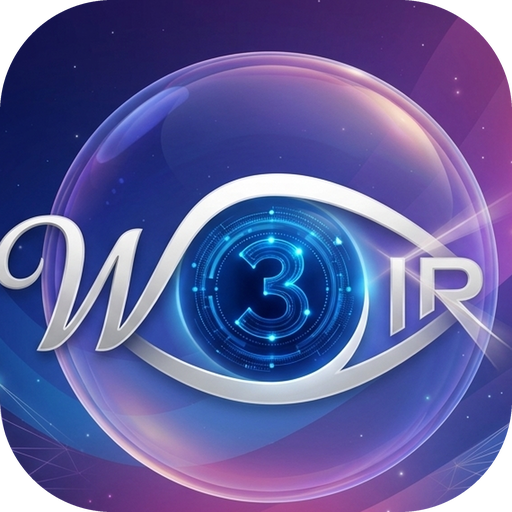

<p align="center"></p>

# W3IR Browser

Браузер для Windows на основі Chromium (Electron 41) з упором на приватність, безпеку й зручність. Усі функції працюють локально, без облікових записів і серверів розробника.

- Поточна версія: **1.19.0** · Завантаження: <https://github.com/ech2corrosionrrd/w3ir-browser/releases/latest>
- Мова інтерфейсу: українська · Платформа: Windows 10/11 x64
- Довідка в самому браузері: **F1**

## Можливості

| Область | Що є |
|---|---|
| **Вкладки** | закріплені (помітна «пілюля», хрестик при наведенні), сплячі (економія пам'яті), вертикальний режим, **групи з кольорами** («закрити інші в групі»), **винесення вкладки в нове вікно** (перетягування за межі панелі), відновлення закритих і сесії (разом із парою розділеного екрана), перетягування |
| **Навігація** | адресний рядок із підказками (закладки, історія), ключові слова (`gh owner/repo`, `npm …`, власні), палітра команд **Ctrl+K**, пошук по вкладках Ctrl+Shift+A, режим читання |
| **Приватність** | блокувальник EasyList/EasyPrivacy/uBlock із косметичними фільтрами, HTTPS-first, очищення трекінгових параметрів, DNT/GPC, інкогніто, **панель «Інформація про сайт»** (дозволи, виняток блокувальника, очищення даних сайту) |
| **Захист від шахрайства** | локальні списки URLhaus + Phishing.Database + MetaMask eth-phishing-detect (~500 тис. доменів, web3-фішинг включно) та евристики (омогліфи, двійники брендів) |
| **Паролі** | зашифроване сховище (AES-256-GCM, scrypt, DPAPI), автозаповнення лише за командою й лише на точному origin, генератор, резервна копія, імпорт CSV |
| **Web3** | вбудований EVM-гаманець (EIP-1193/6963), підтвердження кожної дії довіреним вікном, розшифровка небезпечних approve/permit |
| **Синхронізація** | закладки через вибрану теку (OneDrive/Dropbox/Syncthing), наскрізне шифрування |
| **Профілі** | окремі cookie, закладки, історія, паролі, налаштування й синхронізація |
| **Імпорт** | закладки й історія з Chrome/Edge/Brave/Vivaldi/Firefox; паролі — через CSV |
| **GitHub** | сповіщення й запити на рев'ю (🐙), команди для репозиторіїв у Ctrl+K, ключові слова `gh`, `ghi`, `ghp`, `gha`, `ghc` |
| **Розділений екран** | дві вкладки поруч у одному вікні, межу можна перетягувати мишею, обмін панелей |
| **Панель** | Bento-сторінка стану: мережі гаманця з пінгом RPC, адреса з копіюванням, керування ШІ, захист, журнал |
| **Керування ШІ** | вбудований локальний сервер MCP (вимкнений за замовчуванням) для Claude Code зі вашою підпискою: ШІ працює в окремому тимчасовому вікні (кожен сайт підтверджуєте ви) або у ваших вкладках, якими ви самі поділилися (читання чи керування); паролі, гаманець і ваші входи в окремому вікні недоступні |
| **Торенти** | `magnet:` і `.torrent` передаються у зовнішній клієнт (з попередженням) |
| **Вигляд** | фірмовий стиль W3IR (глибокий індиго, неонові акценти, «скло»; темна/світла/системна тема), нова вкладка з брендом, бічна навігація в налаштуваннях, довідка, підказки при наведенні |
| **Оновлення** | автоматичні, підписані ключем випускача (Ed25519), диференційне завантаження, журнал `updater.log` |

## Встановлення й оновлення

1. Завантажте `W3IR-Browser-Setup-*.exe` зі сторінки Releases (встановлювач підтримує автооновлення) або портативну `W3IR-Browser-*-portable.exe` (автоматично не оновлюється).
2. Windows SmartScreen може попередити про невідомого видавця — програму ще не підписано сертифікатом Microsoft (див. [дорожню карту](docs/ROADMAP.md)).
3. Оновлення: Налаштування → «Оновлення браузера» → «Перевірити оновлення» (також автоматично кожні 6 годин). Встановлення тихе й триває 15–30 с — не відкривайте браузер вручну.
4. `winget install W3IR.Browser` — після схвалення пакета (PR [#454063](https://github.com/microsoft/winget-pkgs/pull/454063), потрібен CLA).

## Дані користувача

- Встановлена версія: `%APPDATA%\W3IR Browser` (у режимі розробки — `%APPDATA%\w3ir-browser`); додаткові профілі — у підтеці `profiles\<id>`.
- Файли: `settings.json`, `bookmarks.json`, `history.json`, `session.json`, `permissions.json`, `downloads.json`, `window.json`, `vault.bin` + `vault.pepper` (паролі й гаманець, зашифровано), `github.token` (DPAPI), `sync.json` + `sync.key`, `threats-*.bin`, `adblock-engine.bin`, `profiles.json`, `updater.log`.
- Кеш оновлень: `%LOCALAPPDATA%\w3ir-browser-updater`.

## Для розробників

```
npm install
npm start                      # запуск із вихідного коду
npm test                       # повний автотест у тимчасовому профілі (код виходу 1 при збоях)
W3IR_USER_DATA=<тека> W3IR_SMOKE=security npx electron .   # 469 автоматичних перевірок
npm run release                # збірка + підпис оновлення → dist/release
npm run check:rpc               # онлайн-перевірка вбудованих RPC гаманця
npm run icon                   # перегенерація фірмових ресурсів із build/brand (Python, Pillow, numpy, scipy)
npm run release:github -- ech2corrosionrrd/w3ir-browser    # публікація через чернетку
npm run winget:submit          # PR із маніфестами winget
```

Документація:

- [docs/ARCHITECTURE.md](docs/ARCHITECTURE.md) — модулі, процеси, IPC, схема даних
- [docs/SECURITY.md](docs/SECURITY.md) — модель загроз і криптографія
- [docs/AUDIT.md](docs/AUDIT.md) — відповідь на зовнішній аудит: вердикти й виправлення
- [docs/TESTING.md](docs/TESTING.md) — як запускати й що перевіряють тести
- [docs/RELEASING.md](docs/RELEASING.md) — випуск, підпис, GitHub, winget
- [docs/AI-MCP.md](docs/AI-MCP.md) — Claude Code керує браузером: підключення, зони, приклади
- [docs/PLAN.md](docs/PLAN.md) — план розвитку по етапах
- [docs/BRANDING.md](docs/BRANDING.md) — фірмовий стиль, палітра, ресурси
- [docs/ROADMAP.md](docs/ROADMAP.md) — поточний стан, відкриті питання, плани
- [CHANGELOG.md](CHANGELOG.md) — історія версій

## Відомі обмеження

Немає DRM (Widevine: Netflix тощо), розширення Chrome підтримуються частково, Solana/Bitcoin та апаратні гаманці не підтримуються, вхід у Google інколи блокується для Electron-браузерів, код гаманця незалежно не аудитований, інсталятор не підписаний сертифікатом видавця.
